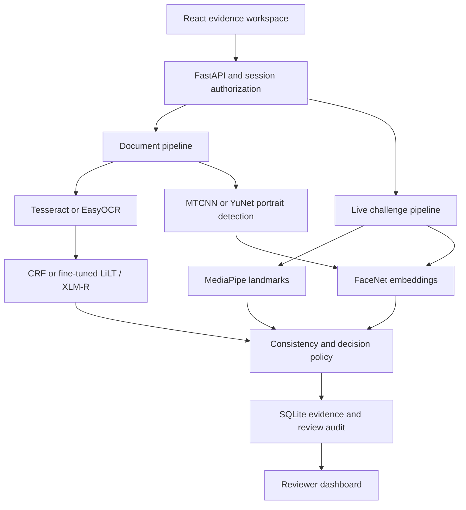

# Architecture

React sends sequential JPEG frames over HTTP from a live MediaStream; this is a video capture flow, not a WebRTC media-server implementation. One FastAPI process serializes model work using locks. SQLite stores case metadata, preview images, OCR outputs, scores and review history; active challenge state is in memory. Restarting invalidates active challenges, but stored cases survive.

Images are size bounded, decoded through Pillow, EXIF oriented and converted to OpenCV BGR arrays. A photo must have a detected quadrilateral; a user-selected flat scan uses its existing boundaries. Portrait regions are masked for OCR to reduce spurious text from faces. OCR boxes and token confidence feed the learned field extractor.

The CRF uses BIO labels, neighboring words, line context and normalized coordinates. Numeric word features use digit shapes to reduce synthetic number memorization. Transformer inference supports overlapping 512-token windows; LiLT receives normalized boxes. A selected but missing transformer fails explicitly rather than switching to CRF.

The challenge randomizes the order of slow blink and left/right turns, with neutral/center stages. Eye aspect ratio is calibrated from open-eye frames; hysteresis and consecutive observations distinguish close/reopen. Head movement uses a nose-to-eye-width proxy, not a 3D yaw angle. Landmarks and FaceNet continuity are calculated on the server. The final accepted frame supplies the comparison embedding.

Current locks, SQLite and in-memory state are for a single-machine college demo. Horizontal scaling requires persistent shared challenge state, object storage, a job queue and proper reviewer identity management.
