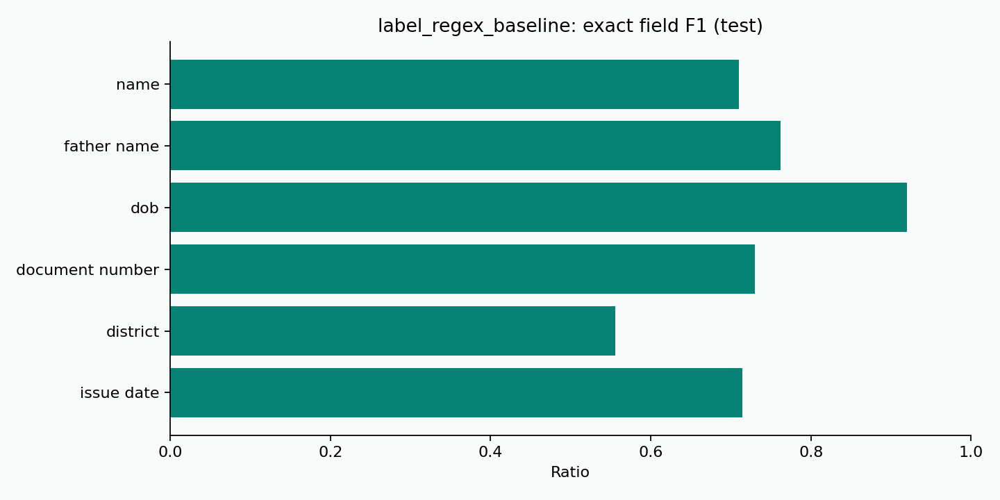
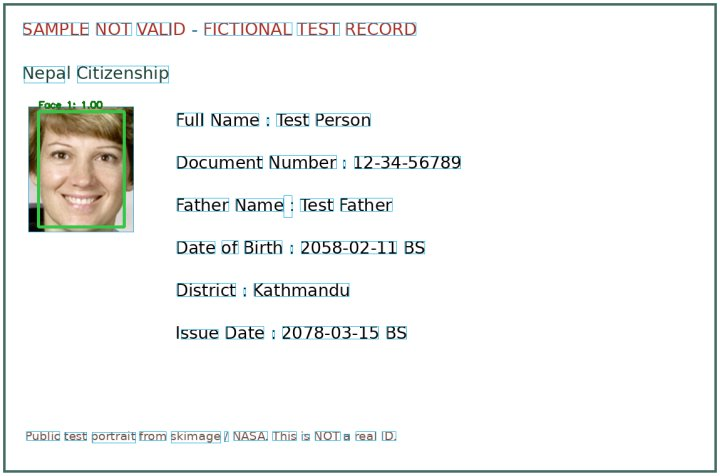
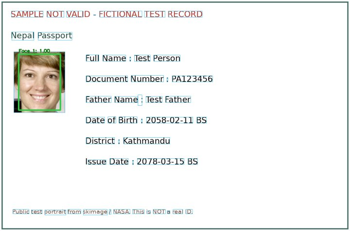
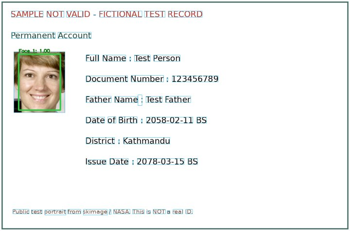
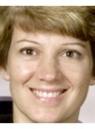

# VisionKYC v2 — project report draft

Sunway College, Kathmandu  
Group: Prasanna Sen Thakuri, Shovit Kafle, Samyog Rajbhandari

## Scope and research questions

This revision implements a document-and-video evidence pipeline using real pretrained face/landmark/OCR inference and learned field extraction. It addresses the original demo's missing intelligence, while keeping performance claims separate from implementation. Research questions are: which OCR engine best reads Nepali IDs, which field extractor generalizes to unseen layouts, how do detector/FaceNet choices affect ID-selfie verification, and how often do active liveness checks accept presentation attacks?

The system does not contact a government issuer. Structural validity, OCR consistency, facial similarity and user movement are different evidence types; none establishes document issuance on its own. A realistic forgery and adaptive replay remain unresolved threats.

## Baseline versus implemented revision

| Area | Uploaded baseline | Revision |
|---|---|---|
| Recognition | 32×32 grayscale/DCT descriptor in demo mode | Neural FaceNet, two pretrained variants |
| Detection | Haar with largest-face selection | Explicit MTCNN or YuNet; ambiguity shown |
| Document understanding | Unknown/placeholder unless custom model supplied | OCR, learned fields, document rules, MRZ and consistency checks |
| Liveness | Bypassed in demo | Randomized active challenge, 478 landmarks and continuity |
| NLP | None | Trained CRF seed baseline plus LiLT/XLM-R training path |
| Results | Generic review shell | Evidence-based decisions with explicit calibration gates |
| Evaluation | Not supplied | Reproducible datasets, metrics, chart exporters and honest pending studies |

The former pixel descriptor is not retained as an online fallback. The offline field comparator is a simple label/colon parser. End-to-end empirical baseline-versus-final face and liveness results remain pending real data.

## Methods

The architecture and interfaces are specified in [ARCHITECTURE.md](ARCHITECTURE.md) and [API.md](API.md). OCR produces bilingual text, coordinates and confidence. The CRF uses BIO sequence labels, surrounding words, line context and coordinates. A training script supports LiLT with XLM-R and text-only XLM-R; no fine-tuned transformer performance is claimed yet.

Document rules identify citizenship, passport and PAN headings and validate expected evidence. Dates in different calendars and names in different scripts are marked uncertain. Portrait detection yields the displayed crop; normalized FaceNet embeddings are compared with cosine similarity. The final matching threshold is chosen on validation identities, then evaluated on separate test identities. Active blink/head movement is analyzed from MediaPipe landmarks and tied to the final server-held selfie frame.

The referenced CHiPSAL paper studies Nepali scanned notice extraction. We adopt the idea of OCR-token/layout-based information extraction. Its dataset, labels and reported metrics are not directly transferable to KYC and are not presented as our results.

## Measured synthetic sanity check

240 synthetic bilingual text records: 160 training, 40 validation and 40 test. Every row has a distinct synthetic identity; the held-out name vocabularies are separated. Templates remain simple and related, so this is **not** an estimate of accuracy on real IDs. OCR tokens are supplied for this experiment, so OCR errors are excluded. Numeric features use digit shapes to avoid day-number shortcuts.

| Field | Label/colon baseline F1 | CRF F1 |
|---|---:|---:|
| name | 0.710 | 1.000 |
| father name | 0.762 | 1.000 |
| dob | 0.920 | 1.000 |
| document number | 0.730 | 1.000 |
| district | 0.556 | 1.000 |
| issue date | 0.714 | 1.000 |

High synthetic scores primarily demonstrate that the software learns and evaluates labels correctly. They must not be reported as real KYC accuracy. See the machine-readable observations and exact denominators in `evaluations/seed_ner/`.

## Actual portrait extraction examples

These are deliberately invalid layouts with a public-domain test portrait and fictional text. All three were processed by real models and flagged with `sample_document`. The passport example additionally lacks a valid MRZ. They show extraction, not authentication.

| Family | Annotated document | Extracted portrait |
|---|---|---|
| Citizenship |  |  |
| Passport |  |  |
| PAN |  |  |

## Real-data evaluation still to complete

| Experiment | Required evidence | Current result |
|---|---|---|
| OCR | 10–50 consented annotated document images; both engines | Pending |
| Field extraction | Real BIO labels and exact-field P/R/F1 | Pending |
| Detector comparison | Manually annotated face boxes, IoU metrics | Smoke checked; empirical comparison pending |
| Face verification | ≥50 people, genuine and impostor pairs, validation/test identity split | Smoke checked; empirical comparison pending |
| Lighting pilot | All 3 members under normal, dim and backlit conditions | Pending |
| Liveness | Bona fide, printed photo, phone photo and phone replay trials | Policy tested; attack evaluation pending |
| Failure analysis | ≥20 observed cases with root-cause evidence | Worksheet supplied; collection pending |

Use [DATASET.md](DATASET.md), [EVALUATION.md](EVALUATION.md) and [FAILURE_ANALYSIS.md](FAILURE_ANALYSIS.md). Preserve all failed detections/trials in denominators. Do not choose thresholds on test data. The frozen pretrained FaceNet study needs no training split, but the field extractor does.

## Limitations and improvements

Real Nepali handwriting, ornate fonts, worn cards, glare, ghost portraits, transliteration and BS/AD conversion require more data and explicit policy. Synthetic CRF scores are optimistic; fine-tuned LiLT/XLM-R should be evaluated on real held-out IDs. OCR confidence and NER marginals are uncalibrated. Very small impostor sets cannot justify a strong low-FAR claim. Active liveness has no dedicated learned PAD classifier and cannot defeat all screen/video injection attacks. Authenticity needs trusted issuer or cryptographic verification beyond the supplied components.

Engineering improvements include shared persistent challenge state, attended reviewer video if required, proper multi-user reviewer authentication, encrypted storage, audited retention, calibration confidence intervals and independently validated anti-spoofing. This is an academic implementation, not a production identity assurance service.

## Contributions and sources

See [CONTRIBUTIONS.md](CONTRIBUTIONS.md) for assistance disclosure and genuine Git workflow guidance. No historical team contributions were fabricated. Model and paper references are in [MODELS.md](MODELS.md). Validation actually performed is in [TEST_REPORT.md](TEST_REPORT.md).
